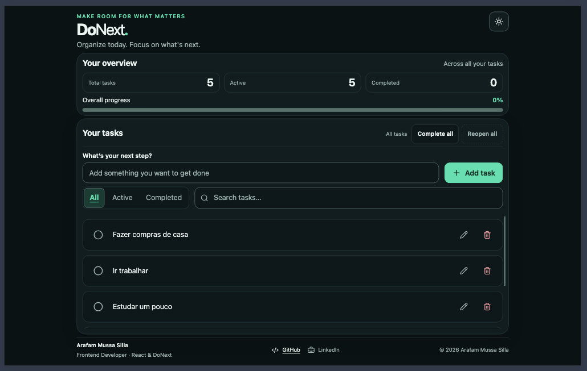
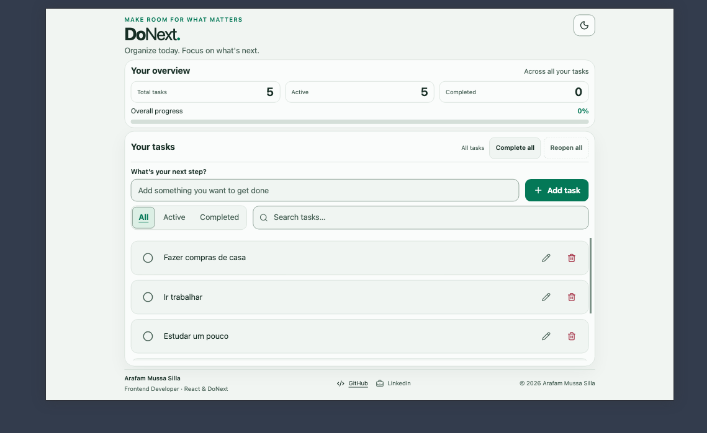
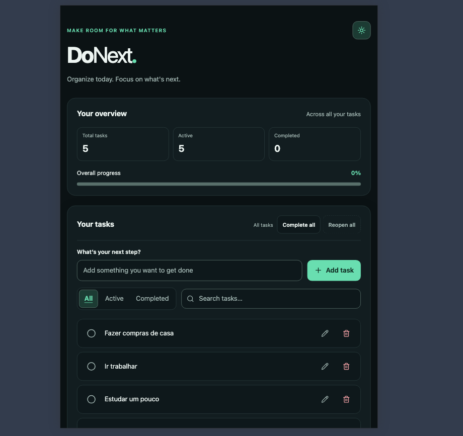
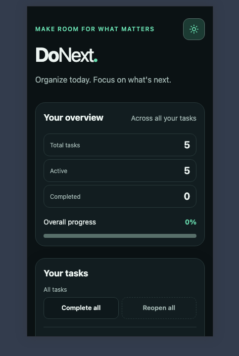

# DoNext

A responsive task manager built with React, designed to help you organize your day and focus on what comes next. Create tasks, track your progress and switch between dark and light themes.

## Live Demo

**[Open DoNext](https://do-next-app.vercel.app/)**

## Application Preview

### Desktop · Dark Theme



### Desktop · Light Theme



### Responsive Design

|                                                    Tablet                                                    |                                                   Mobile                                                    |
| :----------------------------------------------------------------------------------------------------------: | :---------------------------------------------------------------------------------------------------------: |
|  |  |

The tablet and mobile screenshots show portions of the responsive interface.

## Features

- **Task management:** Create, edit, complete, reopen and delete tasks, with title validation and inline deletion confirmation.
- **Search and filters:** Combine All, Active and Completed filters with case-insensitive title search.
- **Bulk actions:** Complete or reopen every task, including tasks hidden by filters or search.
- **Progress:** View total, active and completed tasks alongside overall completion progress.
- **Themes:** Switch between dark and light modes, with system preference detection and a saved manual choice.
- **Local persistence:** Keep tasks between sessions, with storage validation and protection against stale-tab writes.
- **Accessibility:** Semantic landmarks, labelled native controls, visible keyboard focus, Escape to cancel editing or deletion, and accessible feedback.
- **Responsive design:** Mobile layouts, internal list scrolling on suitable desktops and reduced-motion support.

## Tech Stack

- **Frontend:** React 19, JavaScript (JSX), Vite 8
- **Styling:** Vanilla CSS with shared design tokens and responsive layouts
- **Icons:** Lucide React
- **State and storage:** React state and props, localStorage, Web Locks API
- **Testing and quality:** Node.js Test Runner, ESLint, Prettier
- **Deployment:** Vercel

## Getting Started

Use Node.js 22.12+ or a newer supported release, and npm.

```bash
git clone https://github.com/arafamdev/do-next.git
cd do-next
npm ci
npm run dev
```

Open the local URL printed by Vite. No API key or environment file is required.

To preview the production build locally:

```bash
npm run build
npm run preview
```

## Testing and Validation

```bash
node --test src/features/tasks/utils/taskStorage.test.js
npm run lint
npm run format:check
npm run build
git diff --check
```

Storage tests cover successive saves, stale tabs, competing and queued writes, unsafe recovery, unavailable coordination and read/write failures using isolated mocks. They complement manual browser checks of keyboard navigation, layout and real Web Locks behavior.

Use `npm run format` to format project files with Prettier.

## Architecture

`src/app/App.jsx` owns task state and passes data and callbacks to components in `src/features/tasks/`. Filters, statistics and progress are derived from the task array; editing drafts and deletion confirmations remain local to each task item.

Shared UI and theme logic live in `src/shared/`. Design tokens are defined in `src/styles/globals.css`, with layout and component styles in `src/styles/app.css`. State and props keep the architecture simple without an external state library.

See [Architecture and maintenance](docs/ARCHITECTURE.md) for the project structure, component responsibilities, focus handling and persistence details.

## Limitations

Tasks are stored only in the current browser profile and origin using localStorage. There are no accounts or cross-device synchronization, and clearing browser data can remove tasks.

Safe task saving requires Web Locks. If coordination is unavailable, the app remains usable in memory and displays a warning. Conflicts between cooperating tabs and invalid or partially recovered data pause saving to preserve stored data; local edits remain in memory. Copy unsaved changes before reloading or closing a blocked tab. Local storage is not a backup.

## Author

**Arafam Mussa Silla — Frontend Developer**

[GitHub](https://github.com/arafamdev) · [LinkedIn](https://www.linkedin.com/in/arafam-mussa-silla-5a7866446/) · [Live Demo](https://do-next-app.vercel.app/)
